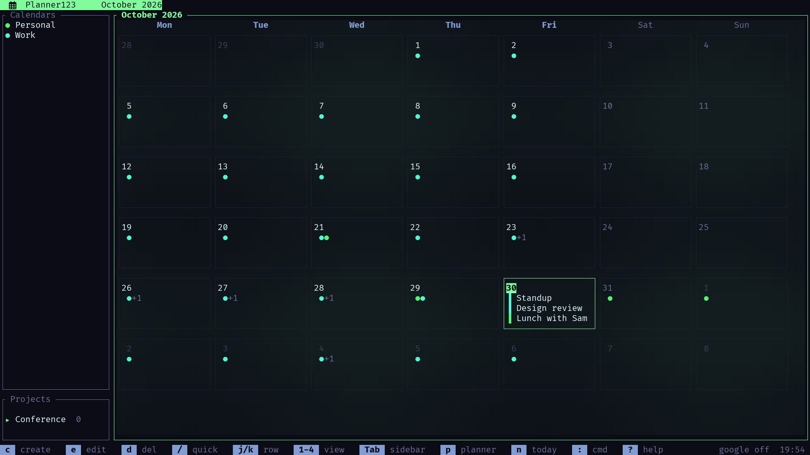
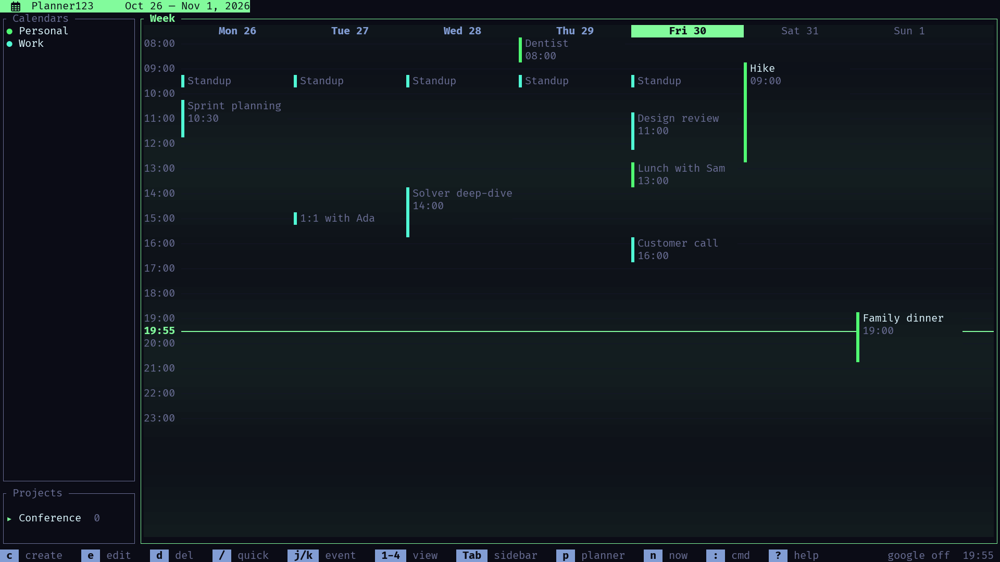
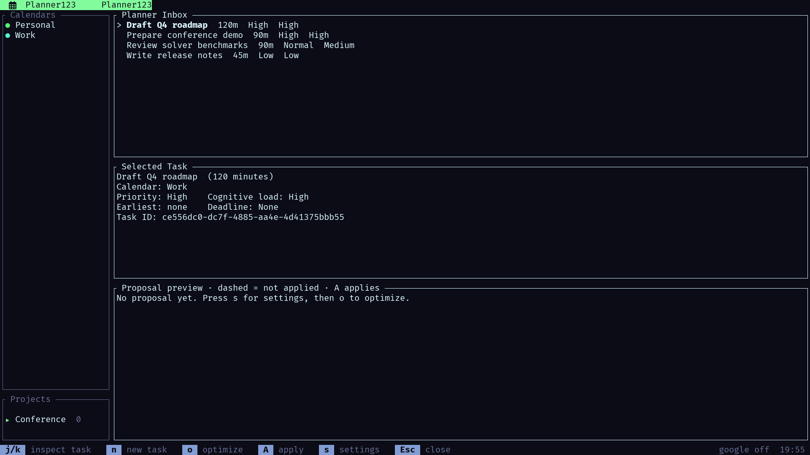
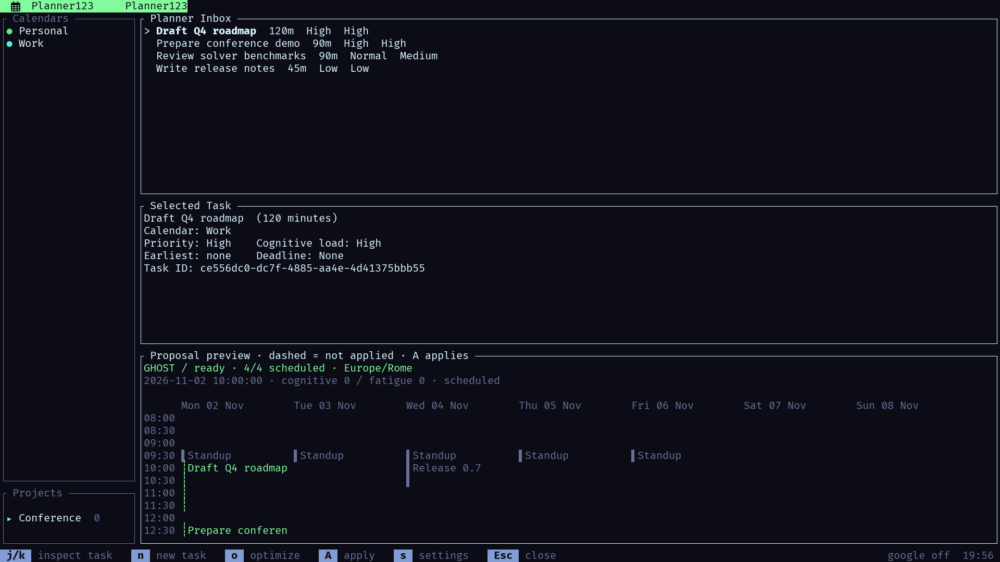
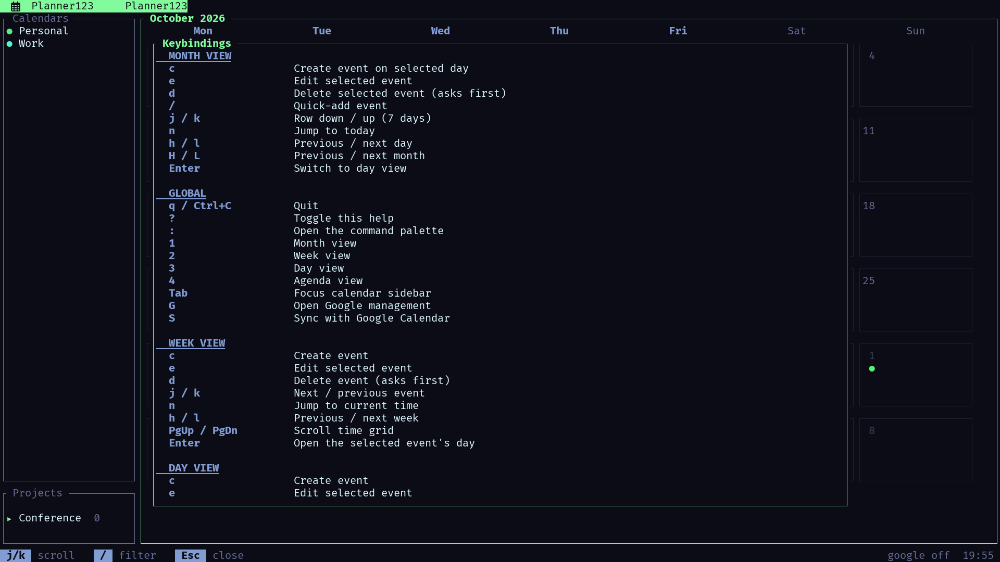

A calendar that lives on your machine, runs in your terminal, and schedules your to-do list for you: around your meetings, inside your hours, before your deadlines. Nothing lands on the calendar until you approve it.

Most calendars only remember what is already scheduled. Planner123 also holds the work that has no time yet. Give each task a duration, a priority, a cognitive load, and a deadline; press `o` and the SolverForge planner proposes a concrete slot for every task it can place; press `A` and only then do the tasks become events. Events live in a local SQLite file, with optional two-way Google Calendar sync and `.ics` import and export.

Ratatui TUI
Local SQLite
SolverForge planner
Google Calendar sync
Proposals change nothing

## See it plan a week

<video controls preload="metadata" playsinline poster="poster.png" aria-label="Planner123 planning a week: the inbox fills, the planner proposes a slot for every task, and one key writes the plan into the calendar."><source src="planner123.mp4" type="video/mp4" /></video>

The week loads under copper bars, the month turns into a plasma, the Planner Inbox fills with five tasks, and each one flies to its slot on the downbeat before a single key writes the plan into the calendar.

## A calendar that plans

<article class="timeline-item">
  

  

    <header><h3>Planner Inbox</h3>Tasks
Work that exists but has no time yet
</header>
    

Each task carries a duration, a priority, an optional cognitive load, an earliest start, and a hard or soft deadline. Settings declare your timezone, your weekly working hours, split shifts included, and the windows in which you do your best deep work.

  

</article>

<article class="timeline-item">
  

  

    <header><h3>The planner</h3>SolverForge
Fourteen constraints, one start slot per task
</header>
    

Every task gets one planning variable, its start slot, and may stay unplaced when the week is full. Existing events are busy time, work lands only inside declared hours, hard deadlines and dependencies always hold, soft-deadline lateness outranks every deep-work preference, and high-load tasks are steered toward focus windows with recovery breaks between them.

  

</article>

<article class="timeline-item">
  

  

    <header><h3>Review, then apply</h3>Control
Dashed means proposed, not saved
</header>
    

The proposal opens as a read-only preview on the time grid. Applying it is one transaction; a stale proposal is refused; <code>return-to-inbox</code> removes exactly one scheduled task's event and nothing else.

  

</article>

<article class="timeline-item">
  

  

    <header><h3>Agents and scripts</h3>JSON CLI
Every feature without a keystroke
</header>
    

<code>planner123-cli</code> speaks JSON on stdout and stderr with no prompts, covering calendars, events, tasks, Google sync, conflicts, and the whole planner workflow. A portable agent skill teaches the contract to Codex, opencode, and other agents.

  

</article>

## Screenshots

## Links

<a href="https://github.com/blackopsrepl/Planner123">blackopsrepl/Planner123</a>

<a class="button" href="https://github.com/blackopsrepl/Planner123" target="_blank"> Source and setup</a>
<a class="button" href="https://solverforge.org/use-cases/planner123/" target="_blank"> On solverforge.org</a>
