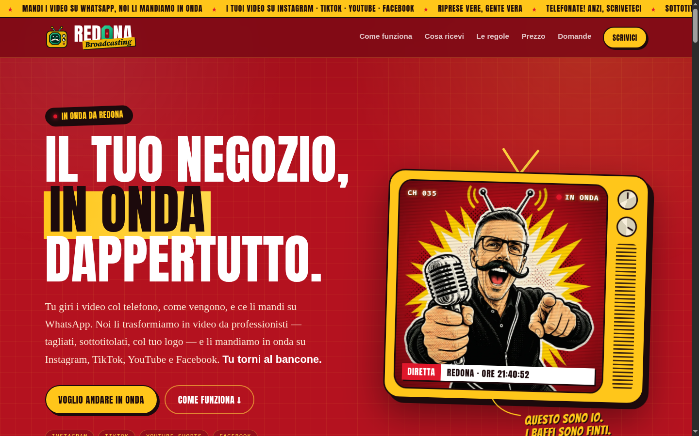
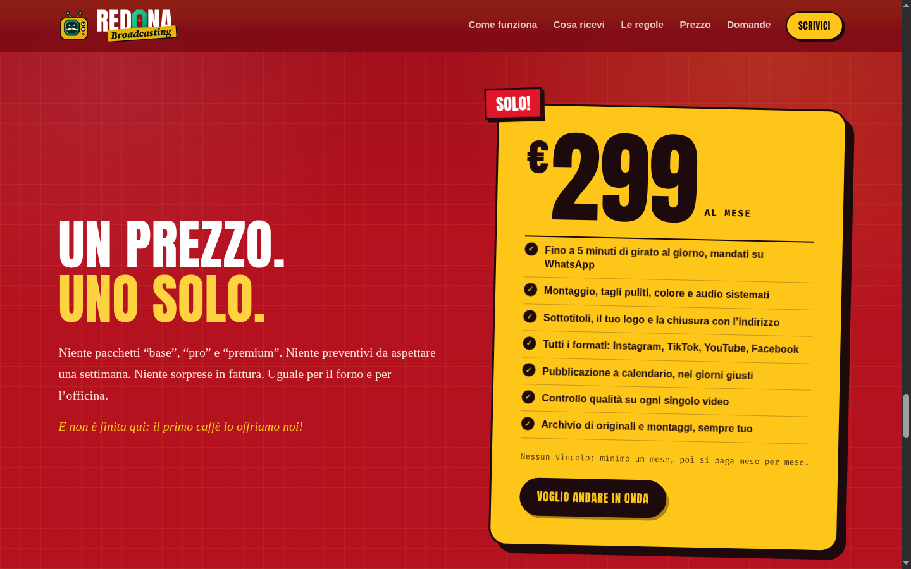
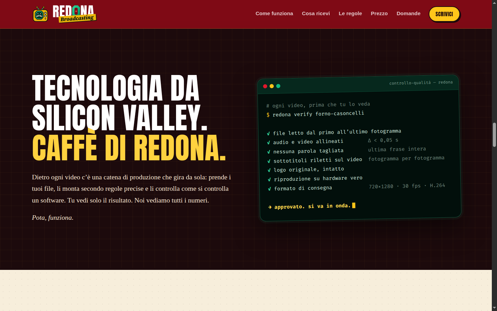

A video studio for the shops in my neighbourhood. The baker, the barber and the bar send me what they shot on their phone, over WhatsApp. They get back edited, captioned vertical videos for Instagram, TikTok, YouTube and Facebook, at a flat €299 a month.

Redona is my neighbourhood in Bergamo. Its shops don't need an agency or a strategy deck. They need someone to turn five minutes of shaky phone footage into something worth posting. Redona Broadcasting does that with an AI agent doing the editorial judgement and deterministic code doing everything that has to be exactly right.

The public face is an [Italian one-page site](/redona/) with a mascot, the Baffo: me, as a 1990s Italian TV-shopping host. Underneath it is a production studio rebuilt from an OpenShorts fork.

WhatsApp intake
Agent-planned edits
Verified before review
Real footage only
Redona, Bergamo

## The page

Italian only, very local, deliberately loud: Bergamo's red and yellow, a TV-shopping mascot, one price, no tiers. The technology appears once, in a terminal window, as the list of checks every video passes. The page sells the outcome, not the AI.

## How a video gets made

<article class="timeline-item">
  

  

    <header><h3>Intake</h3>Files
Originals copied, hashed and probed, never modified
</header>
    

Each job keeps the client's files exactly as received, with SHA-256 hashes and probe data including phone rotation. Transcription is Whisper only, pinned, with word-level timestamps.

  

</article>

<article class="timeline-item">
  

  

    <header><h3>The agent plans</h3>Judgement
A Hermes agent writes a versioned JSON edit plan
</header>
    

Which moments, which cut, which captions. The agent follows a versioned skill and works in two modes: merge several clips into one edit, or split one long video into vertical clips. No model is called from inside the studio code; the agent's only output is the plan.

  

</article>

<article class="timeline-item">
  

  

    <header><h3>Code validates</h3>Rules
The plan is rejected unless it obeys the editing rules
</header>
    

Cuts only in word gaps, with room after the last word. Picture and sound from the same take for speech. Captions only over voiced segments. The client's logo unaltered, checked by hash. These are enforced by a validator, not by prompt wording.

  

</article>

<article class="timeline-item">
  

  

    <header><h3>Render</h3>Deterministic
Headless FilmCraft, with an ffmpeg fallback behind the same plan
</header>
    

The same plan on the pinned toolchain gives the same output: three independent renders of the first client job produced byte-identical masters. One delivery profile for every platform.

  

</article>

<article class="timeline-item">
  

  

    <header><h3>Verify</h3>Gates
Checked before a human ever sees it
</header>
    

Full decode, audio/video alignment, re-transcription against the plan so no sentence is clipped, OCR of the burned captions on real frames, and playback on real GPU hardware in a private headless compositor. A version that passes every gate is approved automatically into the review ledger.

  

</article>

## Rules the studio keeps

- **Real footage only.** No generated video, voices, actors or dubbing. The shop owner is in the video, in the shop.
- **The client's brand is never altered.** Logos are used as supplied.
- **The agent decides, code enforces.** Everything a model could get subtly wrong is a validator rule or a verification gate.

## Status

The first client, a bakery, is live, with a paid month and delivered reels. The manual workflow runs end to end, from files to verified, auto-approved versions in the ledger. The editing skill has also passed on a second model: given only the skill and the original clips, it produced a valid plan that passed every gate.

<a class="button" href="/redona/"> Redona Broadcasting (Italian)</a>
